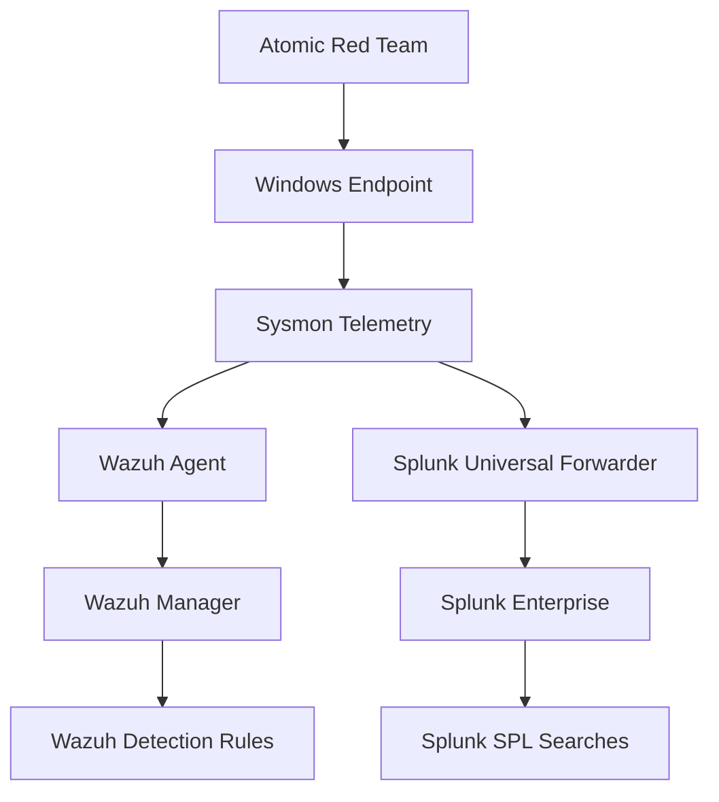

# Endpoint Threat Detection & Validation Lab
Sysmon · Wazuh · Splunk · Atomic Red Team · MITRE ATT&CK
A hands-on endpoint detection engineering lab that collects Windows endpoint telemetry with Sysmon, forwards it to two independent SIEM platforms (Wazuh and Splunk), and validates detection coverage using controlled, MITRE ATT&CK-mapped simulations with Atomic Red Team.
> **Lab Scope:** This repository documents a three-VM VMware home lab consisting of a Windows endpoint, a Wazuh server, and a Splunk server. Attack simulations are performed only in an isolated, authorized environment. Results reflect the tests documented in this repository and do not claim complete detection coverage.
## At a Glance

| Area | Implementation |
|---|---|
| Endpoint Telemetry | Sysmon on Windows |
| SIEM Pipeline 1 | Wazuh agent, manager, custom XML rules |
| SIEM Pipeline 2 | Splunk Universal Forwarder, Splunk Enterprise, SPL searches |
| Adversary Simulation | Atomic Red Team |
| Detection Mapping | MITRE ATT&CK |
| Lab Virtualization | VMware Workstation |
| Documentation | Architecture, setup notes, simulation logs, screenshots |
## Architecture

The lab uses three virtual machines on an isolated host-only network. Attack simulations are performed only in an authorized environment.

## Repository Structure

| Directory / File | Description |
|---|---|
| `docs/` | Architecture and technical documentation |
| `screenshots/` | Visual evidence from the lab |
| `wazuh-rules/` | Custom Wazuh detection rules |
| `splunk-searches/` | Splunk SPL detection searches |
| `attack-simulation/` | Attack simulation procedures and results |
| `LICENSE` | MIT License |
## Detection Validation Results

Five MITRE ATT&CK technique scenarios were documented during lab validation.

| MITRE ATT&CK ID | Technique | Validation Result |
|---|---|---|
| T1059.001 | PowerShell Encoded Command | Detected by Wazuh and Splunk |
| T1547.001 | Registry Run Key Persistence | Detected by Wazuh and Splunk |
| T1218.010 | Regsvr32 | Blocked by Windows Defender |
| T1003.001 | LSASS Memory Access | Blocked by Windows Defender |
| T1071.001 | Application Layer Protocol | Detected by Wazuh and Splunk |

### Results Analysis

- **3 scenarios:** Detected by both Wazuh and Splunk.
- **2 scenarios:** Blocked by Windows Defender before reaching SIEM validation.
- **Detection coverage:** Results reflect documented tests only, not complete detection coverage.

See [Attack Simulation Log](attack-simulation/attack-simulation-log.md) for detailed test procedures and results.
## Key Engineering Contributions

- Configured Sysmon for Windows endpoint telemetry collection.
- Established independent event ingestion pipelines for Wazuh and Splunk.
- Developed custom Wazuh XML detection rules.
- Created Splunk SPL searches for endpoint threat detection.
- Troubleshot Windows Event Log permissions and Splunk forwarding.
- Validated attack scenarios using Atomic Red Team.
- Documented detection results, troubleshooting procedures, and technical findings.
## Reproduce the Lab

1. Review the architecture and setup documentation in `docs/`.
2. Create an isolated virtual network in VMware Workstation.
3. Configure the Windows endpoint and install Sysmon.
4. Install and configure the Wazuh agent.
5. Configure the Splunk Universal Forwarder.
6. Verify that endpoint events reach both SIEM platforms.
7. Review the Wazuh detection rules and Splunk searches.
8. Execute authorized Atomic Red Team tests individually.
9. Capture screenshots and document detection results.
10. Restore the lab environment after testing.

## Contributions and attribution
This repository presents the lab implementation and technical work documented by its owner, including environment configuration, telemetry forwarding, detection-rule authoring, troubleshooting, simulation validation, and documentation. Third-party tools, configurations, and Atomic Red Team test definitions remain the work of their respective authors and retain their licenses and attribution.
For a precise contribution record, distinguish work personally implemented and tested from third-party tools/configurations used as dependencies. Do not claim a test, detection, dashboard, or deployment unless the repository contains evidence that it was completed.
## Roadmap

- [ ] Create a detection coverage matrix mapping rules to MITRE ATT&CK techniques.
- [ ] Add dedicated Wazuh detections for additional attack scenarios.
- [ ] Build a Splunk dashboard for detection monitoring.
- [ ] Add sanitized screenshots with captions and test details.
- [ ] Document a repeatable lab build and reset procedure.
- [ ] Add CI checks for documentation and rule-file formatting.
## Safety
Run simulations only on systems you own or are explicitly authorized to test. Use isolated VMs, snapshots, test-by-test execution, and documented cleanup. Never commit credentials, tokens, personal data, or sensitive production logs.
## References
- [Atomic Red Team](https://github.com/redcanaryco/atomic-red-team)
- [MITRE ATT&CK](https://attack.mitre.org/)
- [Microsoft Sysmon](https://learn.microsoft.com/en-us/sysinternals/downloads/sysmon)
- [Wazuh Documentation](https://documentation.wazuh.com/)
- [Splunk Documentation](https://docs.splunk.com/)
