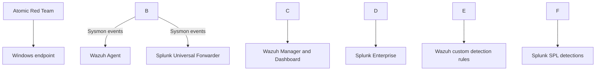

Endpoint Threat Detection & Validation Lab
Sysmon · Wazuh · Splunk · Atomic Red Team · MITRE ATT&CK
A hands-on endpoint detection engineering lab that collects Windows endpoint telemetry with Sysmon, forwards it to two independent SIEM platforms (Wazuh and Splunk), and validates detection coverage using controlled, MITRE ATT&CK-mapped simulations with Atomic Red Team.
> \*\*Lab scope:\*\* This repository documents a three-VM VMware home lab: a Windows endpoint, a Wazuh server, and a Splunk server. Attack simulations are performed only in an isolated, authorized environment. Results below reflect the tests documented in this repository; they are not a claim of complete coverage.
At a glance
Area	Implementation
Endpoint telemetry	Sysmon on Windows
SIEM pipeline 1	Wazuh agent, manager, custom XML rules
SIEM pipeline 2	Splunk Universal Forwarder, Splunk Enterprise, SPL searches
Adversary simulation	Atomic Red Team
Detection mapping	MITRE ATT&CK
Lab virtualization	VMware Workstation
Documentation	Architecture, setup notes, simulation log, screenshots
Architecture

The lab uses three virtual machines on an isolated host-only network. Replace any environment-specific hostnames and addresses in public documentation with generic labels before publishing.
Repository contents
`docs/` — architecture and technical write-ups.
`screenshots/` — visual evidence from the lab.
`wazuh-rules/` and `local\_rules.xml` — custom Wazuh detection logic.
`splunk-searches/` and root-level `.spl` files — Splunk detection searches.
`attack-simulation-log.md` — recorded test procedures and outcomes.
Detection validation summary
The current documented test set covers five ATT&CK technique scenarios:
Technique	Scenario	Documented outcome
T1059.001	Encoded PowerShell command	Detected by Wazuh and Splunk
T1547.001	Registry Run Key persistence	Detected by Wazuh and Splunk
T1218.010	Regsvr32	Blocked by Windows Defender before SIEM validation
T1003.001	LSASS memory access	Blocked by Windows Defender before SIEM validation
T1071.001	User-agent / outbound traffic behavior	Detected by Wazuh and Splunk
Interpretation: Three scenarios were reported as successfully executed and detected by both SIEM stacks. Two were blocked by Windows Defender before the SIEM pipeline could observe the behavior. Those two are prevention outcomes, not successful SIEM detections. See `attack-simulation-log.md` for the detailed evidence and caveats.
Key engineering work documented
Instrumented a Windows endpoint with Sysmon telemetry.
Configured Wazuh and Splunk as independent event ingestion and detection paths.
Authored custom Wazuh XML rules and Splunk SPL searches for selected endpoint behaviors.
Investigated a Splunk forwarding issue involving Windows event-log access permissions.
Documented agent naming and time-synchronization troubleshooting.
Used Atomic Red Team for controlled technique validation and recorded cases where endpoint protection blocked execution.
Reproduce the lab
See the existing setup documentation in `docs/` and the simulation record before rebuilding or running tests.
Build an isolated virtual network and the three lab VMs.
Configure Sysmon and confirm events are visible locally.
Install and enroll the Wazuh agent; verify events at the manager.
Configure the Splunk Universal Forwarder; verify events are indexed.
Review each detection rule and its expected telemetry.
Snapshot the endpoint before each Atomic Red Team test.
Run one authorized test at a time, capture SIEM evidence, perform cleanup, and revert if needed.
Do not disable endpoint protection simply to force a test to execute. Record prevention events accurately.
Contributions and attribution
This repository presents the lab implementation and technical work documented by its owner, including environment configuration, telemetry forwarding, detection-rule authoring, troubleshooting, simulation validation, and documentation. Third-party tools, configurations, and Atomic Red Team test definitions remain the work of their respective authors and retain their licenses and attribution.
For a precise contribution record, distinguish work personally implemented and tested from third-party tools/configurations used as dependencies. Do not claim a test, detection, dashboard, or deployment unless the repository contains evidence that it was completed.
Roadmap
[ ] Add a single-page detection coverage matrix linking each rule to event IDs, ATT&CK technique, and validation evidence.
[ ] Add dedicated Wazuh detections for LOLBin and outbound-connection scenarios, then validate them.
[ ] Build a Splunk dashboard showing the five test scenarios and detection status.
[ ] Add sanitized screenshots with captions, test date, and environment details.
[ ] Add a repeatable lab build and reset procedure.
[ ] Add CI checks for documentation and rule-file formatting.
Safety
Run simulations only on systems you own or are explicitly authorized to test. Use isolated VMs, snapshots, test-by-test execution, and documented cleanup. Never commit credentials, tokens, personal data, or sensitive production logs.
References
Atomic Red Team
MITRE ATT&CK
Microsoft Sysmon
Wazuh documentation
Splunk documentation